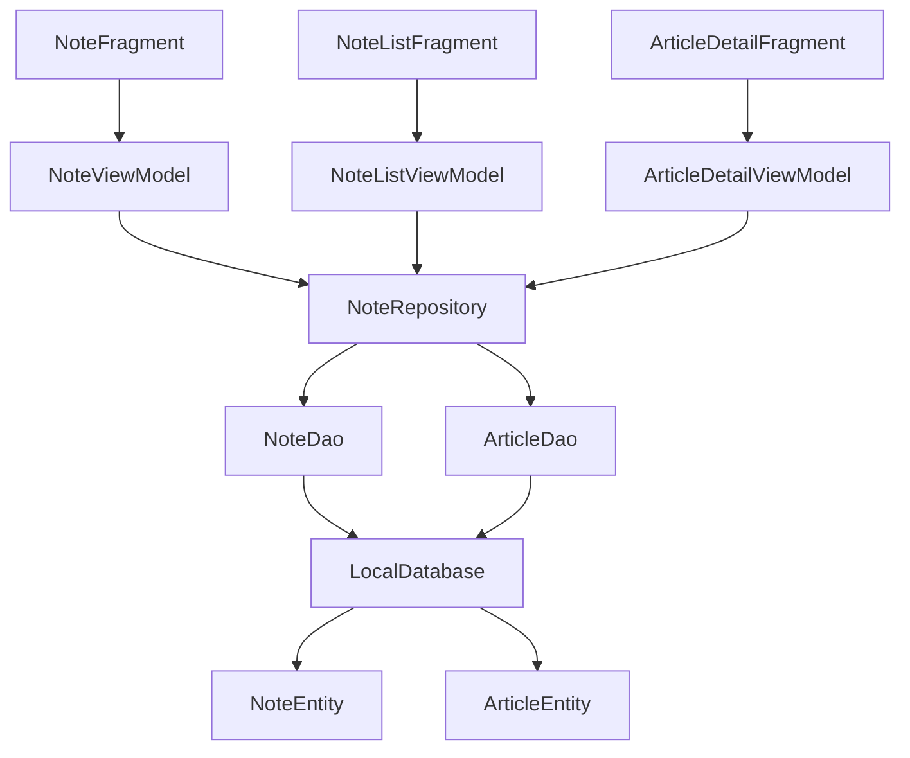

# 学习笔记功能设计文档

## 概述

学习笔记功能将集成到现有的WanLearning应用中，允许用户为文章添加、编辑、删除和管理个人笔记。该功能遵循现有的MVVM架构模式，使用Room数据库进行本地存储，并与现有的文章阅读流程无缝集成。

## 架构

### 整体架构
学习笔记功能将遵循现有应用的MVVM架构：
- **Model层**: 笔记数据模型和数据库实体
- **View层**: 笔记相关的Fragment和自定义View
- **ViewModel层**: 笔记业务逻辑处理
- **Repository层**: 数据访问抽象层

### 架构图


## 组件和接口

### 数据层组件

#### 1. NoteEntity (数据实体)
```kotlin
@Entity(
    tableName = "notes",
    foreignKeys = [ForeignKey(
        entity = ArticleEntity::class,
        parentColumns = ["aid"],
        childColumns = ["article_id"],
        onDelete = ForeignKey.CASCADE
    )],
    indices = [Index(value = ["article_id"])]
)
data class NoteEntity(
    @PrimaryKey(autoGenerate = true)
    val id: Long = 0,

    @ColumnInfo(name = "article_id")
    val articleId: Int,

    @ColumnInfo(name = "content")
    val content: String,

    @ColumnInfo(name = "created_at")
    val createdAt: Long,

    @ColumnInfo(name = "updated_at")
    val updatedAt: Long
)
```

#### 2. NoteDao (数据访问对象)
```kotlin
@Dao
interface NoteDao {
    @Query("SELECT * FROM notes WHERE article_id = :articleId ORDER BY created_at DESC")
    suspend fun getNotesByArticleId(articleId: Int): List<NoteEntity>

    @Query("SELECT * FROM notes ORDER BY created_at DESC")
    suspend fun getAllNotes(): List<NoteEntity>

    @Query("SELECT * FROM notes WHERE content LIKE '%' || :keyword || '%' ORDER BY created_at DESC")
    suspend fun searchNotes(keyword: String): List<NoteEntity>

    @Insert
    suspend fun insertNote(note: NoteEntity): Long

    @Update
    suspend fun updateNote(note: NoteEntity)

    @Delete
    suspend fun deleteNote(note: NoteEntity)

    @Query("DELETE FROM notes WHERE article_id = :articleId")
    suspend fun deleteNotesByArticleId(articleId: Int)
}
```

#### 3. NoteWithArticle (关联查询数据类)
```kotlin
data class NoteWithArticle(
    @Embedded val note: NoteEntity,
    @Relation(
        parentColumn = "article_id",
        entityColumn = "aid"
    )
    val article: ArticleEntity
)
```

### Repository层

#### NoteRepository
```kotlin
class NoteRepository(
    private val noteDao: NoteDao,
    private val articleDao: ArticleDao
) {
    suspend fun getNotesByArticleId(articleId: Int): List<NoteEntity>
    suspend fun getAllNotesWithArticles(): List<NoteWithArticle>
    suspend fun searchNotes(keyword: String): List<NoteWithArticle>
    suspend fun insertNote(note: NoteEntity): Long
    suspend fun updateNote(note: NoteEntity)
    suspend fun deleteNote(note: NoteEntity)
    suspend fun getNoteCount(articleId: Int): Int
}
```

### ViewModel层

#### 1. NoteViewModel
```kotlin
class NoteViewModel(
    private val repository: NoteRepository
) : BaseViewModel() {

    private val _noteContent = MutableLiveData<String>()
    val noteContent: LiveData<String> = _noteContent

    private val _saveResult = MutableLiveData<Boolean>()
    val saveResult: LiveData<Boolean> = _saveResult

    fun saveNote(articleId: Int, content: String)
    fun updateNote(noteId: Long, content: String)
    fun loadNote(noteId: Long)
}
```

#### 2. NoteListViewModel
```kotlin
class NoteListViewModel(
    private val repository: NoteRepository
) : BaseViewModel() {

    private val _notes = MutableLiveData<List<NoteWithArticle>>()
    val notes: LiveData<List<NoteWithArticle>> = _notes

    private val _searchResults = MutableLiveData<List<NoteWithArticle>>()
    val searchResults: LiveData<List<NoteWithArticle>> = _searchResults

    fun loadAllNotes()
    fun searchNotes(keyword: String)
    fun deleteNote(note: NoteEntity)
}
```

### View层组件

#### 1. NoteEditFragment
- 功能：笔记编辑界面
- 布局：包含多行文本输入框、保存/取消按钮
- 交互：支持文本输入、保存验证、键盘管理

#### 2. NoteListFragment
- 功能：笔记列表管理界面
- 布局：RecyclerView显示笔记列表、搜索框、空状态视图
- 交互：支持搜索、点击跳转、长按操作菜单

#### 3. NoteItemView
- 功能：笔记列表项自定义视图
- 布局：笔记内容预览、文章标题、时间信息
- 交互：点击事件、长按菜单

#### 4. ArticleDetailFragment增强
- 新增：笔记入口按钮、笔记数量显示
- 集成：与现有文章详情页面无缝集成

### 适配器组件

#### NoteListAdapter
```kotlin
class NoteListAdapter : RecyclerView.Adapter<NoteListAdapter.NoteViewHolder>() {
    interface OnNoteClickListener {
        fun onNoteClick(noteWithArticle: NoteWithArticle)
        fun onNoteLongClick(noteWithArticle: NoteWithArticle)
    }
}
```

## 数据模型

### 核心数据流
1. **创建笔记流程**:
   用户输入 → NoteViewModel → NoteRepository → NoteDao → 数据库存储

2. **查询笔记流程**:
   数据库查询 → NoteDao → NoteRepository → NoteViewModel → UI更新

3. **搜索笔记流程**:
   搜索关键词 → NoteRepository → 模糊查询 → 结果返回 → UI展示

### 数据库设计
- **notes表**: 存储笔记核心信息
- **外键关联**: notes.article_id → articles.aid
- **索引优化**: article_id字段建立索引提升查询性能
- **级联删除**: 文章删除时自动删除关联笔记

## 错误处理

### 数据库操作错误
- **插入失败**: 显示保存失败提示，提供重试选项
- **查询失败**: 显示加载失败状态，提供刷新功能
- **删除失败**: 显示删除失败提示，保持原有状态

### 用户输入验证
- **空内容检查**: 笔记内容不能为空
- **长度限制**: 笔记内容最大长度限制（如5000字符）
- **特殊字符处理**: 过滤或转义特殊字符

### 网络和存储错误
- **存储空间不足**: 提示用户清理空间
- **数据库损坏**: 提供数据库重建选项
- **并发操作冲突**: 使用数据库事务确保一致性

## 测试策略

### 单元测试
1. **Repository测试**
   - 数据库CRUD操作测试
   - 数据转换逻辑测试
   - 异常情况处理测试

2. **ViewModel测试**
   - 业务逻辑测试
   - LiveData状态变化测试
   - 协程操作测试

3. **DAO测试**
   - SQL查询正确性测试
   - 数据关联查询测试
   - 性能测试

### 集成测试
1. **数据库集成测试**
   - 数据库迁移测试
   - 外键约束测试
   - 事务一致性测试

2. **UI集成测试**
   - Fragment导航测试
   - 用户交互流程测试
   - 数据绑定测试

### UI测试
1. **界面功能测试**
   - 笔记编辑界面测试
   - 笔记列表界面测试
   - 搜索功能测试

2. **用户体验测试**
   - 响应时间测试
   - 界面流畅性测试
   - 错误状态显示测试

### 性能测试
1. **数据库性能**
   - 大量数据查询性能
   - 索引效果验证
   - 内存使用监控

2. **UI性能**
   - 列表滚动性能
   - 界面切换流畅度
   - 内存泄漏检测